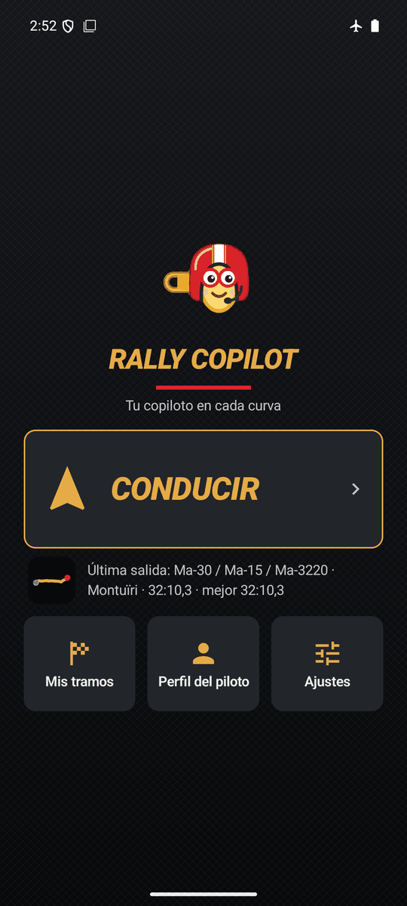
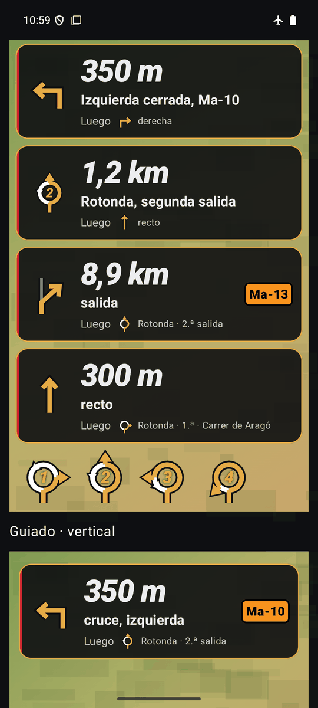
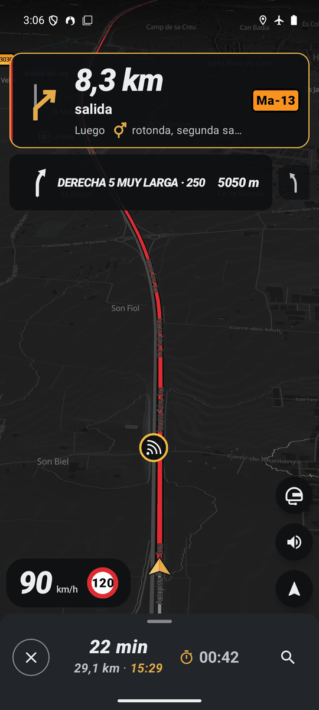
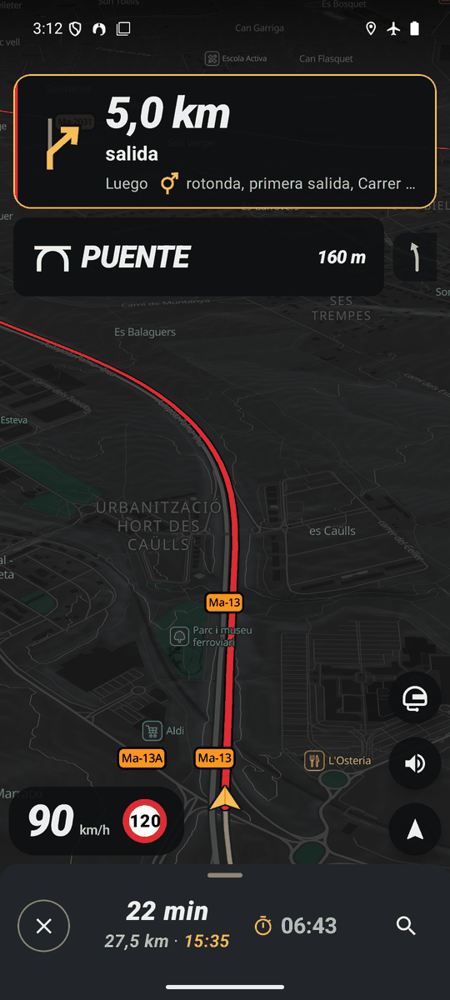
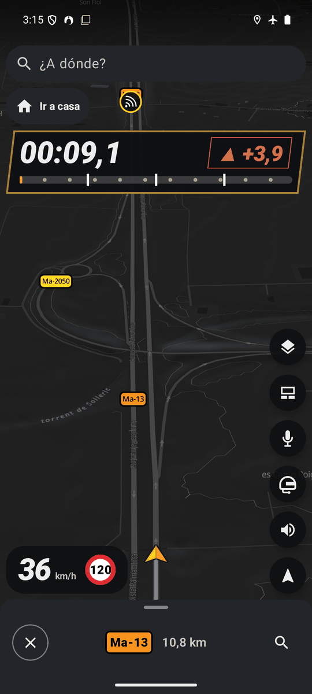
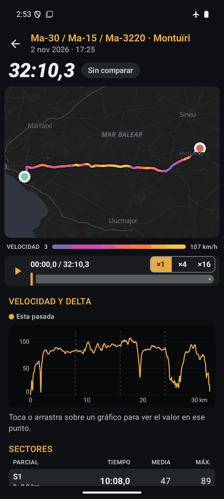
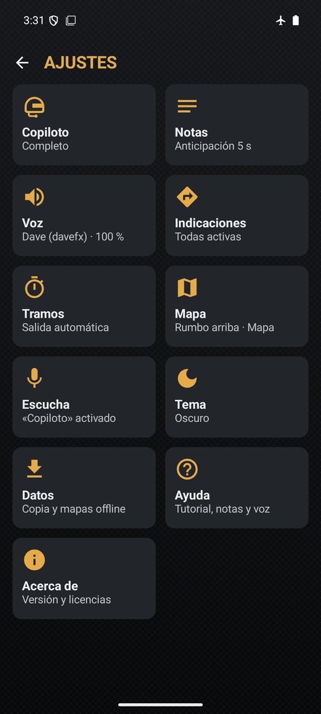

<div align="center">
  
  <h1>Rally Copilot</h1>
  <p><strong>Tu copiloto en cada curva.</strong> Navegación con notas de rally por voz para las carreteras de Mallorca.</p>
  
  
  <a href="https://github.com/trombonet12/Rally-Copilot/releases"></a>
</div>

## ✨ Qué hace

| | |
|---|---|
| 🗣️ **Copiloto por voz** | Lee la carretera con notas de rally generadas a partir de la geometría (curvas detectadas por rumbo): grados 6 a 1 según el giro (6 = 10–30°, 1 = 150–180°), «escuadra» y «horquilla», con «larga», «cierra» y «abre», avisos de puente, cruce o rasante y distancias. Voz sintetizada en el móvil con sherpa-onnx (voces Piper), cuatro modos y notas simplificadas. |
| 🧭 **Navegación sin conexión** | Rutas con Valhalla en el propio móvil (Más rápida o Sinuosa), paradas, recálculo, rotondas con su salida, búsqueda por palabras, coordenadas y enlaces; también con la pantalla apagada. |
| 🗺️ **Mapas offline** | Vectorial (OpenStreetMap, Protomaps) y satélite (PNOA del IGN, z17–z19) de Mallorca, con relieve y curvas de nivel, y precarga de rutas. |
| ⏱️ **Tramos cronometrados** | Salida automática o manual con cuenta atrás de estética WRC, sectores, delta en vivo contra tu mejor pasada, análisis de cada pasada y perfil del piloto. |
| 🚨 **Alertas** | Radares fijos, de tramo y zonas móviles (aviso a unos 15 s y a 100 m) e incidencias de la DGT; exceso de velocidad y media de tramo. |
| 🎙️ **Órdenes por voz** | Di «Copiloto» y una orden: Vosk reconoce sin conexión sobre una gramática cerrada. Incluye tutorial y ayuda dentro de la app. |
| 📂 **Tus datos** | Importar GPX y KML, copia de seguridad exportable y tema oscuro o claro. |

Todo funciona **sin conexión y sin cuentas**: los datos se quedan en el móvil. Internet solo sirve para descargar mapas y
refrescar incidencias. El plan completo está en [ROADMAP.md](ROADMAP.md).

### Capturas

<p align="center">
  
  
  
  
</p>
<p align="center">
  
  
  
</p>

## 📲 Instalación
Con [Obtainium](https://github.com/ImranR98/Obtainium): *Add app* →
`https://github.com/trombonet12/Rally-Copilot` (filtro de APK `rally-copilot-.*\.apk`). Detalles en
[docs/obtainium.md](docs/obtainium.md).

## 🛠️ Desarrollo
- Kotlin, Jetpack Compose (Material 3), Hilt, Room, Navigation type-safe. Módulo `:motor` en Kotlin/JVM puro para la
  lógica crítica (notas, cronometraje, geometría). Mapa y capas en [docs/arquitectura.md](docs/arquitectura.md).
- Requisitos: JDK 21, Android SDK (compileSdk 37, targetSdk 36, minSdk 26: Android 8.0+), Node ≥ 22, Python 3.12.
- ABIs: la release lleva solo `arm64-v8a` (APK de 167 MiB desde la v1.3; el satélite, el relieve y la voz Sharvard se
  descargan al elegirlos); el debug lleva también `x86_64` para el emulador.

```
python -I scripts/preparar-local-properties.py
./gradlew ktlintCheck detekt lintDebug testDebugUnitTest :motor:test assembleDebug :app:minifyReleaseWithR8
node scripts/gps-replay.mjs docs/rutas/ma-2141-sa-calobra.gpx --kmh 50   # GPS simulado en el emulador
```

Hay tres trazas reales de Mallorca para simular el GPS; ver [docs/rutas/README.md](docs/rutas/README.md).

| Documento | Para qué |
|---|---|
| [ROADMAP.md](ROADMAP.md) | Plan por hitos y su estado |
| [docs/ESTADO.md](docs/ESTADO.md) | Estado de la sesión y próxima acción |
| [CLAUDE.md](CLAUDE.md) | Reglas de trabajo con Claude Code |
| [docs/arquitectura.md](docs/arquitectura.md) | Módulos, capas, hilos, base de datos y flujo GPS → notas → voz |
| [docs/DECISIONES.md](docs/DECISIONES.md) | Decisiones técnicas y versiones |
| [docs/glosario.md](docs/glosario.md) | Qué frases genera el copiloto y cuándo |
| [docs/obtainium.md](docs/obtainium.md) | Publicar la release e instalarla con Obtainium |
| [docs/auditoria/2026-11.md](docs/auditoria/2026-11.md) | Auditoría de noviembre de 2026 |
| [docs/HERENCIA.md](docs/HERENCIA.md) | Qué se hereda de Sous Chef y Trombito |
| [QUESTIONS.md](QUESTIONS.md) | Preguntas de producto y sus respuestas |
| [docs/investigacion/](docs/investigacion/) | Investigaciones previas (enrutado, mapas, notas, DGT, voz) |

## 📜 Licencia y atribuciones
Código bajo [GPL-3.0](LICENSE). Datos y componentes de terceros:

- **Mapas y vías:** datos © colaboradores de [OpenStreetMap](https://www.openstreetmap.org/copyright) (ODbL).
- **Satélite y relieve:** ortofotos PNOA y modelo digital del terreno MDT05 © [Instituto Geográfico Nacional](https://www.ign.es) (CC BY 4.0).
- **Radares e incidencias:** [DGT](https://nap.dgt.es), Punto de Acceso Nacional (NAP). Condiciones de reutilización: VERIFICAR con la DGT.
- **Mapa vectorial:** [Protomaps](https://protomaps.com) (BSD-3 y CC0), tipografía Noto Sans (SIL OFL) y [MapLibre Native](https://maplibre.org) (BSD-2).
- **Rutas:** [Valhalla](https://github.com/valhalla/valhalla) y valhalla-mobile (MIT).
- **Voz del copiloto:** [sherpa-onnx](https://github.com/k2-fsa/sherpa-onnx) (Apache-2.0), onnxruntime (MIT), [espeak-ng](https://github.com/espeak-ng/espeak-ng) (GPL-3.0), [Piper](https://github.com/rhasspy/piper) y la voz davefx (dataset CC0; licencia de los pesos derivados: VERIFICAR) y la voz Sharvard (corpus Sharvard, Universidad de Edimburgo, CC BY 3.0).
- **Órdenes por voz:** [Vosk](https://alphacephei.com/vosk/) y el modelo vosk-model-small-es-0.42 (Apache-2.0, Alpha Cephei); JNA (Apache-2.0 / LGPL-2.1).

<sub>Desarrollado por Trombonet12© and Co. Interactive Systems Solutions · https://www.trombonet12.es/</sub>
