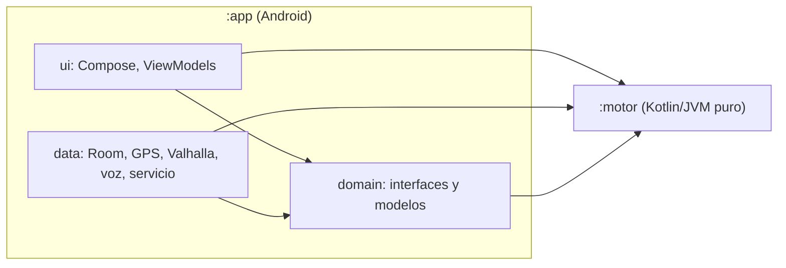
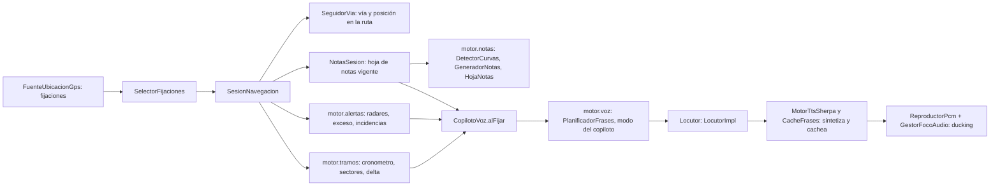

# Arquitectura

> Propósito: mapa corto de módulos, capas, hilos, base de datos y del flujo GPS → notas → voz · Audiencia: agentes y quien revise o toque la arquitectura · Actualizado: 2026-11-07 · Relacionado: [DECISIONES.md](DECISIONES.md), [glosario.md](glosario.md), [../CLAUDE.md](../CLAUDE.md)

## Resumen
Rally Copilot son dos módulos Gradle. `:motor` es Kotlin/JVM puro (geometría, notas, cronometraje, sectores, deltas, GPX/KML, frases de voz) y no toca Android, disco ni red. `:app` es la aplicación Android (Compose, Hilt, Room, MapLibre, Valhalla, sherpa-onnx, Vosk) organizada en tres capas con dependencias en un solo sentido. Las decisiones y las versiones viven en [DECISIONES.md](DECISIONES.md); este documento solo describe la forma del código y dónde está cada cosa. Si algo cambia en el código, manda el código.

## Módulos y capas

- `:motor` (`motor/src/main/kotlin/app/trombito/rallycopilot/motor/`): paquetes `alertas`, `analisis`, `busqueda`, `datos`, `edicion`, `geo`, `importar`, `mapa`, `notas`, `precarga`, `ruta`, `tramos`, `velocidad`, `vias`, `voz`. Lógica determinista y testeable en la JVM, con goldens de la Ma-2141 y la Ma-10 para las notas.
- `:app`, paquete `app.trombito.rallycopilot`: `ui/` (pantallas Compose y ViewModels, navegación type-safe en `AppNavHost.kt`), `domain/` (contratos y modelos que la interfaz consume), `data/` (implementaciones: Room, GPS, Valhalla, sherpa-onnx, Vosk, servicio de navegación, descargas) y `di/` (módulos Hilt).
- **Regla de dependencias**, vigilada por `DomainDependencyRuleTest` (`app/src/test/.../architecture/`), que escanea los imports de `app/src/main`:
  - `domain` no importa `android.`, `androidx.`, `dagger` ni `javax.inject`, ni `data` ni `ui`;
  - `ui` no importa `data`;
  - `data` no importa `ui` (la lista blanca de excepciones está vacía y otro test avisa si queda una entrada obsoleta).
  En la práctica: `ui → domain ← data`; la interfaz habla con interfaces del dominio y Hilt enlaza las implementaciones de `data`.
- `:motor` no depende de `:app`. Desde H15 (lote L9) la lógica pura que aún vive en `:app` se mueve a `:motor` (VERIFICAR estado en [../ROADMAP.md](../ROADMAP.md) § H15).

## Modelo de hilos
- **Scopes y dispatchers inyectados** (`di/Alcances.kt`, auditoría de noviembre de 2026, ARQ-11 y ARQ-12): `@ApplicationScope` es el único `CoroutineScope` de vida de proceso (`SupervisorJob` + `Dispatchers.Default`, no se cancela) y `@DispatcherIo` / `@DispatcherDefault` entregan `Dispatchers.IO` y `Dispatchers.Default`. Los singletons y repositorios los reciben por constructor (con un constructor interno que admite otro en los tests); `AlcancesModule` es el sitio donde se nombran (quedan pendientes de recibirlos el servicio de navegación, `LiberadorModelos`, `DescargadorArchivo` y `RallyCopilotApplication`). `DomainDependencyRuleTest` vigila que `domain/` no nombre ningún dispatcher, que `ui/` solo nombre `Dispatchers.Main`, que `:motor` no importe `android`/`androidx` y que no haya `GlobalScope` ni `runBlocking` en producción (lista blanca justificada en el propio test).
- **Servicio de navegación** (`data/navegacion/ServicioNavegacion.kt`, servicio en primer plano): su `CoroutineScope` usa `SupervisorJob` y `Dispatchers.Default.limitedParallelism(1)`; es el único scope con ciclo de vida propio (se cancela en `onDestroy`, tras esperar a que la sesión vuelque y cierre). Un solo hilo lógico porque `SesionNavegacion` no es concurrente y los recálculos no deben pisar a las posiciones. Un manejador de excepciones registra el tipo de fallo (nunca coordenadas ni URLs), publica el fallo y detiene el servicio. El bucle de «Copiloto» (escucha continua) se lanza desde el mismo servicio y vive lo que él.
- **`NotasSesion`** (`data/notas/NotasSesion.kt`): calcula la hoja de notas en `@DispatcherDefault` mientras el servicio sigue atendiendo posiciones; su estado mutable (seguidor de vía, origen de las notas, ediciones) se protege con un candado (`synchronized(candado)`). Es una segunda forma de serializar, distinta del `limitedParallelism(1)` del servicio y correcta (todo el estado se toca solo con el candado); si algún día se unifica, es el candidato.
- **Posición compartida** (`data/ubicacion/PosicionEnVivo.kt`, `ui/mapa/CanalizacionGps.kt`; lotes L3 y L10): `FuenteUbicacionGps.fijaciones()` es un flujo frío (cada colector registraría sus listeners). `PosicionEnVivo` lo comparte con `shareIn(WhileSubscribed)` en `@ApplicationScope`: una sola suscripción al GPS y un solo estimador de velocidad y rumbo para el mapa, la sesión y las respuestas de voz. Los listeners se registran con el primer consumidor y se retiran al irse el último. `CanalizacionGps` (una por `MapaViewModel`, con estado) consume esas posiciones y compone la lectura del mapa (señal, vía, ajuste al camino, caducidad de la velocidad); el ViewModel solo hace `stateIn`.
- **Interfaz**: los ViewModels recogen flujos publicados por `data` a través de `domain` (`stateIn` con `WhileSubscribed(PARADA_MS)` de `ui/comun`); el mapa (MapLibre) y Compose corren en el hilo principal.
- Tests con corrutinas: sin reloj real; los dispatchers se inyectan.

## Inyección y ámbitos Hilt
- `@Binds` cuando una clase tiene `@Inject constructor` y solo hay que enlazarla a su interfaz; `@Provides` solo si la construcción tiene lógica (archivos, clientes HTTP, lambdas como el reloj).
- `@Singleton` solo para lo que tiene estado o es caro de crear (base de datos, cachés, fuente de GPS, sesiones, cargadores de archivos). Los repositorios que solo envuelven un DAO sin estado (`RepositorioTramosRoom`, `RepositorioGuiadoPendienteRoom`, ediciones y marcas) no llevan ámbito.

## Base de datos (Room v16)
- `RallyDatabase` (`data/db/RallyDatabase.kt`): `version = 16`, `exportSchema = true` (esquemas en `app/schemas/`). Tablas de datos de mapas y ajustes, recorridos, guiado pendiente, tramos y pasadas, marcas y ediciones de notas.
- Las migraciones son objetos `MIGRATION_n_m` en `data/db/Migrations.kt` y se registran con `addMigrations(...)` al construir la base (`di/DatosMapaModule.kt`). No hay migración destructiva: toda subida de versión lleva su migración y su test.
- Últimas versiones: v13 filtros de indicaciones, v14 salida manual del cronómetro (H14b), v15 y v16 de H14 (el detalle por versión no está registrado en DECISIONES: VERIFICAR). H15 prevé v17 con lista única de migraciones y test de la cadena completa (lote L4).
- La copia de seguridad exportable (H14b, `data/copia/`) es un zip con `rally.db` y `manifest.json` (sin mapas, voces ni modelos); al importar se valida el zip y se inspecciona la base (`LectorZipCopia`, `InspectorBase`), y H15 (lote L7) endurece esa inspección.

## Flujo GPS → notas → voz

1. El servicio recibe fijaciones del GPS del dispositivo (`FuenteUbicacionGps`, sin Google Play Services; `SelectorFijaciones` elige entre GPS y red) y las filtra por precisión; una fijación válida entra en `SesionNavegacion`.
2. La sesión proyecta la posición sobre la ruta o, en modo libre, sobre la carretera prevista (`SeguidorVia`), actualiza el cronómetro y calcula las alertas.
3. `NotasSesion` genera la hoja de notas de la ruta (curvas por rumbo, grado por ángulo; ver [glosario.md](glosario.md)); `SelectorNotas` elige las siguientes con la anticipación configurada.
4. `CopilotoVoz` recibe notas vigentes, progreso, alertas y delta, y el planificador decide qué frase se dice, en qué orden y con qué prioridad según el modo del copiloto.
5. El locutor sintetiza las frases por adelantado con sherpa-onnx (voces Piper), las cachea y las reproduce bajando el volumen de la música (ducking).

La escucha de órdenes («Copiloto», Vosk con gramática cerrada) entra por `data/escucha/` e `InterpreteOrdenes` (`:motor`), y actúa sobre la misma sesión.

## Qué no cubre
- Modelo de datos detallado de Room, testing y runbooks: no hay documento propio (VERIFICAR si se quieren; auditoría DOC-33).
- Voz de Luis Moya (H11) y Play: pospuestos; ver [../ROADMAP.md](../ROADMAP.md).
