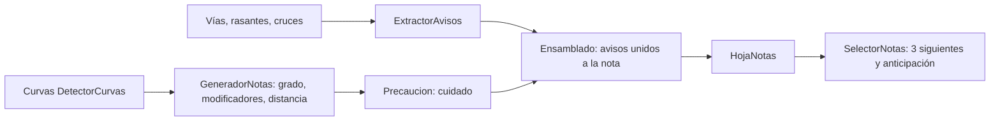

# Glosario de copiloto (notas de rally)

> Propósito: fijar qué frases genera el motor de notas, cuándo salen y con qué umbral · Audiencia: agente principal, Joan y quien calibre o revise las notas (H3, H11) · Actualizado: 2026-10-31 · Relacionado: docs/investigacion/notas-de-rally.md, docs/DECISIONES.md

## Resumen
Este glosario describe lo que **de verdad** produce `motor/` (paquete `notas`), no un borrador: cada frase, su condición y un ejemplo real de los goldens `motor/src/test/resources/notas/ma-2141-hoja.txt` y `ma-10-hoja.txt`. Una nota tiene la forma `[cuidado,] [avisos unidos,] dirección grado [modificadores] [, distancia]`, con dirección siempre primero. El grado sale de la velocidad de curva `v = √(μ·g·R)`, con μ = 0,6 por defecto, y los umbrales son calibrables. Todos los números de este documento son los valores por defecto del código; si cambian, manda el código.

## Forma de la frase de una curva

| Parte | Regla | Fuente |
|---|---|---|
| `cuidado,` | Solo si la nota lleva la marca de precaución (ver § Precaución). | `Precaucion.marcar`, `FrasesNota.base` |
| Avisos unidos | Avisos a menos de 20 m antes de la nota, salvo si la nota anterior va «y» con ella. Ej.: «rasante, derecha tres». | `Ensamblado.unir` (`UNION_MAX_M` = 20) |
| Dirección | «izquierda» o «derecha». Siempre primero. | `FrasesNota.giro` |
| Grado | «uno» a «seis» (en palabras), o la palabra simplificada (§ Notas simplificadas). | `FrasesNota.enPalabras` |
| Modificadores | `larga` o `muy larga`, luego `cierra` o `abre`. | `GeneradorNotas.modificadores` |
| Distancia | `, y el número en palabras` si el hueco hasta la siguiente no va unido. Ej.: «, cincuenta». | `GeneradorNotas.distanciaA` |
| «y» | Sin distancia cuando la nota va unida a la siguiente. El motor no escribe la «y» en la frase de la hoja; la añade el test de los goldens (`HojaNotasRealTest`). `FrasesNota.secuencia` une con « y » o separa con «. » para la voz. | `Nota.unidaConSiguiente`, `FrasesNota.secuencia` |

Horquilla: «horquilla izquierda» (sin grado y sin modificadores).

### Ejemplos reales de curvas (goldens)

| Frase del golden | Qué muestra | Golden |
|---|---|---|
| `595 m  derecha cuatro, doscientos cincuenta` | Grado 4, distancia 250 m a la nota siguiente | ma-2141 |
| `905 m  izquierda cinco y` | Grado 5 unido («y») a la siguiente | ma-2141 |
| `290 m  izquierda dos abre, treinta` | Modificador «abre», distancia 30 m | ma-2141 |
| `975 m  cuidado, derecha tres muy larga abre y` | Precaución, «muy larga», «abre», unida | ma-2141 |
| `1285 m  derecha tres larga y` | «larga» (arco ≥ 80 m, grado ≤ 4) | ma-2141 |
| `140 m  cuidado, derecha dos larga cierra y` | Precaución por grado 1–2 que cierra | ma-2141 |
| `1385 m  cuidado, horquilla izquierda y` | Horquilla con precaución | ma-2141 |
| `1555 m  cuidado, horquilla derecha, cincuenta` | Horquilla con distancia | ma-2141 |
| `4480 m  izquierda cuatro larga abre, cien` | «cien» (100 m) | ma-2141 |
| `6460 m  derecha cuatro, ciento cincuenta` | «ciento cincuenta» (150 m) | ma-2141 |
| `10445 m  derecha cuatro, ciento cincuenta` | Grado 4 con distancia | ma-2141 |
| `8330 m  derecha cuatro cierra y` | «cierra» | ma-2141 |
| `15990 m  derecha tres, quinientos` | Distancia de 500 m (máximo de la lista) | ma-10 |

## Grados y radio

Tabla radio → grado con μ = 0,6, g = 9,81 y `factor` = 1 (valores por defecto de `TablaGrados`). Los radios son **calculados** con `R = (v/3,6)² / (μ·g)` a partir de los umbrales del código; no están medidos en carretera.

| Grado | v_curva (km/h) | Radio central aprox. | Nota |
|---|---|---|---|
| 1 | < 45 | < 26,5 m | Muy cerrada |
| 2 | 45 a < 65 | 26,5 a < 55 m | Cerrada |
| 3 | 65 a < 85 | 55 a < 95 m | Media |
| 4 | 85 a < 110 | 95 a < 159 m | Media-rápida |
| 5 | 110 a < 140 | 159 a < 257 m | Suave |
| 6 | ≥ 140 | ≥ 257 m | Casi recta |
| Horquilla | — | radio central < 30 m y ángulo ≥ 140° | Sin grado |

- `v_curva = √(μ·g·R)·3,6·factor`; el grado es el número de umbrales (45, 65, 85, 110, 140 km/h) que la velocidad alcanza, más uno.
- **Límite de la vía:** si `v_curva` alcanza la velocidad de referencia `vRefKmh` (límite de la vía o calibración), el grado es **6**. Un grado 6 con ángulo < 20° se omite (no genera nota). `GeneradorNotas.generar`, `TablaGrados.grado`.
- La referencia y la calibración global se definen en docs/DECISIONES.md § Motor de notas (H3) y § Respuestas de Joan a QUESTIONS.md (2026-10-28).

## Modificadores

| Modificador | Condición (código) | Frase |
|---|---|---|
| Larga | Grado ≤ 4 y arco (`finM − inicioM`) ≥ 80 m | «larga» |
| Muy larga | Grado ≤ 4 y arco ≥ 150 m (sustituye a «larga») | «muy larga» |
| Cierra | Grado a la salida ≤ grado a la entrada − 1 | «cierra» |
| Abre | Grado a la salida ≥ grado a la entrada + 1 | «abre» |

- Los grados de entrada y salida salen de los radios de entrada y salida de la curva, con el mismo `vRefKmh`.
- Orden: primero larga/muy larga, luego cierra/abre (orden del enum `Modificador`). Como máximo sale una de cada pareja.
- Las horquillas no llevan modificadores.

## Distancias

- El hueco es el de `finM` de una curva a `inicioM` de la siguiente, redondeado **hacia abajo** a esta lista: 10, 20, 30, 40, 50, 60, 70, 80, 100, 120, 150, 200, 250, 300, 400, 500 metros.
- Se cantan en palabras con `enPalabras` (0–999): «cincuenta», «cien», «ciento veinte», «doscientos cincuenta», «trescientos», «quinientos». Un hueco mayor de 500 m se canta «quinientos».
- **Unida** («y», sin distancia) si el hueco es < 25 m **o** < 1,5 s a la velocidad de la curva (`velocidadCurvaKmh` del radio central). El último de la ruta no lleva distancia.

## Avisos

Avisos de `ExtractorAvisos` (`TipoAviso`). Se cantan solos o unidos a una nota. Dos del mismo tipo a menos de 30 m se reducen a uno (`sinDuplicados`).

| Frase | Origen | Cuándo sale | Ejemplo real (golden) |
|---|---|---|---|
| puente | `bridge` distinto de `no` en una vía de la ruta | Al empezar el tramo de puente | ma-2141 `190 m  puente` |
| túnel | `tunnel` distinto de `no` ni `culvert` | Al empezar el tramo de túnel | ma-10 `9535 m  túnel` |
| rotonda | `junction=roundabout` | Al empezar el tramo; los cruces a 25 m o menos antes de una rotonda no salen | Sin ejemplo en los goldens |
| estrecha | `lanes=1` en vía de doble sentido, o `width` < 5 m | Al empezar el tramo | Sin ejemplo en los goldens |
| cuidado bache | Nodo `bump`, `hump`, `table`, `cushion`, `rumble_strip(s)`, `speed_bump`, `speed_hump` o `speed_table` | En el nodo | ma-2141 `12386 m  cuidado bache` |
| cuidado badén | Nodo `dip` o `ford` | En el nodo | Sin ejemplo en los goldens |
| paso a nivel | Nodo `level_crossing` o `railway_crossing` | En el nodo | ma-10 `1024 m  paso a nivel` |
| stop | Nodo `highway=stop` (si su vía es de la ruta o no tiene aristas) | En el nodo | ma-10 `7876 m  stop` |
| ceda | Nodo `give_way` | En el nodo | ma-10 `322 m  ceda` |
| semáforo | Nodo `traffic_signals` | En el nodo | Sin ejemplo en los goldens |
| cruce | Nodo del grafo con 3 o más ramas (regla en `GrafoVias.cruces`), fuera de rotondas | En el cruce | ma-2141 `48 m  cruce` |
| rasante | Cresta del perfil MDT05: umbrales por defecto `pendienteSubidaCrestaPct` 4 %, `pendienteBajadaCrestaPct` 2 % y `ventanaCrestaM` 60 m | En la cresta | ma-2141 `3230 m  rasante` |
| cambio de rasante | Variación de pendiente ≥ 5 puntos en menos de 40 m (`variacionCambioPuntos`, `ventanaCambioM`) | En el cambio | ma-2141 `223 m  cambio de rasante` |
| salto | Cresta con caída ≥ 12 puntos en menos de 30 m (`variacionSaltoPuntos`, `ventanaSaltoM`) | En la cresta | ma-2141 `2658 m  salto` |
| cuidado | `hazard=*` de la vía, nodo `hazard:*`, o `hazard:curve` sin nota a 30 m (suelto) | En el punto | Sin aviso suelto en los goldens; sale junto a notas como «cuidado,» |

- Prioridad de rasantes: salto > rasante > cambio de rasante, si caen a menos de 30 m (`separacionM`).
- Los avisos unidos se cantan delante de la nota: «cambio de rasante, derecha tres larga cierra y» (ma-2141 `3455 m`).
- Un aviso no se une si cae a una nota que es continuación de una cadena «y»: en ma-2141 `1383 m  cambio de rasante` va suelto, porque la nota de `1285 m` va unida a la de `1385 m`.

## Precaución («cuidado,»)

Marcas generosas a propósito (docs/DECISIONES.md § Respuestas de Joan a QUESTIONS.md (2026-10-28)). Una nota lleva «cuidado,» si cumple **una** de estas (`Precaucion.marcar`):

| Motivo | Umbral |
|---|---|
| Cierra fuerte | Grado 1–2 y «cierra» |
| Rasante antes | Grado 1–3 u horquilla con rasante o salto en los 60 m anteriores |
| Salto de grado | Dos o más grados más cerrada que la nota anterior, y a menos de 150 m de ella |
| Horquilla tras recta | Horquilla tras más de 300 m sin curva |
| Peligro en la curva | `hazard:curve` a 30 m o menos de la curva |

Un aviso «cuidado» unido a una nota que ya lleva «cuidado,» se omite para no repetirlo (`DeNota.frase`).

Ejemplos: ma-2141 `4720 m  cambio de rasante, cuidado, horquilla izquierda, ochenta` (rasante antes de una horquilla); ma-2141 `10725 m  cuidado, derecha dos larga cierra y` (grado 2 que cierra).

## Notas simplificadas

Modo «simplificada» (Ajustes): solo cambia el grado por palabra (`GradoSimplificado`); dirección, horquilla, modificadores, distancias y avisos se mantienen.

| Grado | Palabra |
|---|---|
| Horquilla | horquilla |
| 1–2 | cerrada |
| 3–4 | media |
| 5–6 | suave |

Ej.: «derecha cuatro abre, cincuenta» → «derecha media abre, cincuenta».

## Niveles de anticipación

Distancia para empezar a cantar: `d = v · (T_nivel + t_voz)`, con `t_voz` = 1 s, acotada a [40 m, 400 m] (`Anticipacion`). `T_nivel` por nivel (`NivelAnticipacion`):

| Nivel | T (s) | Distancia a 25 m/s (90 km/h) |
|---|---|---|
| MUY_PRONTO | 8,0 | 225 m |
| PRONTO | 6,5 | 188 m |
| NORMAL | 5,0 | 150 m |
| TARDE | 3,5 | 113 m |
| MUY_TARDE | 2,5 | 88 m |

- `SelectorNotas` devuelve los 3 siguientes elementos desde 5 m por detrás de la posición; `activa` es `true` cuando la distancia ya está dentro de `d`.
- Las distancias de la tabla son cálculos con los valores del código, no pruebas en carretera.

## Decisiones y fuentes

- Calibración, orden dirección-grado, distancias después de la nota, grado 6 cantado y avisos generosos: docs/DECISIONES.md § Respuestas de Joan a QUESTIONS.md (2026-10-28).
- Notas en la franja, notas en modo libre y anticipación en Ajustes: docs/DECISIONES.md § Motor de notas (H3).
- Pipeline, μ = 0,6 y tabla inicial (propuestas): docs/investigacion/notas-de-rally.md.
- Código de referencia: `motor/src/main/kotlin/app/trombito/rallycopilot/motor/notas/` (`FrasesNota.kt`, `Nota.kt`, `Avisos.kt`, `TablaGrados.kt`, `GeneradorNotas.kt`, `HojaNotas.kt`, `Anticipacion.kt`, `DetectorRasantes.kt`); `motor/vias/GrafoVias.kt` para el criterio de cruce.
- Goldens: `motor/src/test/resources/notas/ma-2141-hoja.txt` (Ma-2141, 210 líneas) y `ma-10-hoja.txt` (Ma-10, 346 líneas).

## Pendiente
- **H11 (refinar con transcripciones reales):** si dicen «izquierda» o «izda.»; «recto» o «a fondo» para el grado 6; cómo cantan los grados 5–6; si la distancia va antes o después de la nota (ya decidido: después); «contra», «corta», «abierta»; «cierra a dos» (grado final); pausa de la voz entre notas unidas («y» o punto); cuántas precauciones «cuidado» tolera el piloto.
- Frases sin ejemplo en los goldens (rotonda, estrecha, cuidado badén, semáforo): confirmar con un tramo de Mallorca que las tenga.
- Umbrales y μ: calibrar en carretera (VERIFICAR, ver docs/investigacion/notas-de-rally.md).
- Cobertura de `width` y `lanes` fuera de Ma-2141 (VERIFICAR, ver docs/investigacion/notas-de-rally.md).
