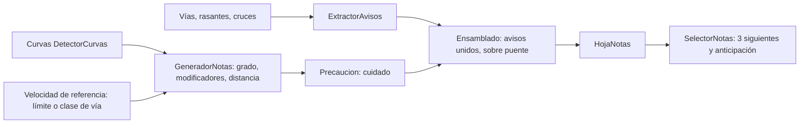

# Glosario de copiloto (notas de rally)

> Propósito: fijar qué frases genera el motor de notas, cuándo salen y con qué umbral · Audiencia: agente principal, Joan y quien calibre o revise las notas (H3, H11) · Actualizado: 2026-10-31 · Relacionado: docs/investigacion/notas-de-rally.md, docs/DECISIONES.md

## Resumen
Este glosario describe lo que **de verdad** produce `motor/` (paquete `notas`), no un borrador: cada frase, su condición y un ejemplo real de los goldens `motor/src/test/resources/notas/ma-2141-hoja.txt` y `ma-10-hoja.txt`. Una nota tiene la forma `[cuidado,] [avisos unidos,] dirección grado [modificadores] [sobre puente] [, distancia]`, con dirección siempre primero. El grado sale de la velocidad de curva `v = √(μ·g·R)` (μ = 0,6 por defecto) comparada con la **velocidad de referencia** de la vía (su límite o, si no lo tiene, el de su clase). Los umbrales son calibrables. Todos los números de este documento son los valores por defecto del código; si cambian, manda el código.

Los goldens llevan al final de cada línea una anotación `[ángulo° R radio m]` que **no** se canta: sirve para revisar la nota a ojo.

## Forma de la frase de una curva

| Parte | Regla | Fuente |
|---|---|---|
| `cuidado,` | Si la nota lleva marca de precaución, o un aviso «cuidado» (resalto, badén, cuidado) va unido. Va siempre primero y se dice una sola vez. | `Precaucion.marcar`, `ElementoHoja.DeNota.frase` |
| Avisos unidos | Avisos a menos de 20 m antes de la nota, también dentro de una cadena «y». Excepción: un cambio de rasante dentro de una cadena «y» se descarta. Ej.: «rasante, derecha tres». | `Ensamblado.unir` (`UNION_MAX_M` = 20) |
| Dirección | «izquierda» o «derecha». Siempre primero. | `FrasesNota.giro` |
| Grado | «uno» a «seis» (en palabras), o la palabra simplificada (§ Notas simplificadas). Horquilla: sin grado. | `FrasesNota.enPalabras` |
| Modificadores | `larga` o `muy larga`, luego `cierra` o `abre`. | `GeneradorNotas.modificadores` |
| «sobre puente» | Un puente que cae dentro del arco de la curva; se canta al final de la nota, antes de la distancia. | `Ensamblado.unir` (`sobrePuente`) |
| Distancia | `, y el número en palabras` si el hueco hasta la siguiente no va unido. Ej.: «, cincuenta». | `GeneradorNotas.distanciaA` |
| «y» | Sin distancia cuando la nota va unida a la siguiente. El motor no escribe la «y» en la frase de la hoja; la añade el test de los goldens (`HojaNotasRealTest`). `FrasesNota.secuencia` une con « y » o separa con «. » para la voz. | `Nota.unidaConSiguiente`, `FrasesNota.secuencia` |

Horquilla: «horquilla izquierda» o «horquilla derecha», con `larga` o `muy larga` si el ángulo lo pide. Sin grado y sin `cierra` ni `abre`.

### Ejemplos reales de curvas (goldens)

| Frase del golden | Qué muestra | Golden |
|---|---|---|
| `595 m  derecha cuatro, doscientos cincuenta` | Grado 4, distancia 250 m a la nota siguiente | ma-2141 |
| `905 m  izquierda cinco y` | Grado 5 unido («y») a la siguiente | ma-2141 |
| `290 m  izquierda dos abre, treinta` | Modificador «abre», distancia 30 m | ma-2141 |
| `140 m  cuidado, derecha dos muy larga cierra sobre puente y` | Precaución por grado 2 que cierra, «muy larga», «sobre puente», unida | ma-2141 |
| `3185 m  cuidado, puente, horquilla derecha muy larga y` | La corbata: puente unido antes de la horquilla, «muy larga» (263°), unida | ma-2141 |
| `3455 m  derecha tres larga cierra y` | «larga» (130°) y «cierra», unida | ma-2141 |
| `3120 m  cuidado, cambio de rasante, izquierda tres y` | Precaución por rasante antes (cambio a 60 m o menos), aviso unido | ma-2141 |
| `1385 m  cuidado, horquilla izquierda y` | Horquilla con precaución, unida | ma-2141 |
| `1555 m  cuidado, horquilla derecha, cincuenta` | Horquilla con distancia | ma-2141 |
| `9605 m  izquierda cuatro abre sobre puente, setenta` | «sobre puente» dentro del arco, con distancia | ma-2141 |
| `4480 m  izquierda cuatro, cien` | «cien» (100 m) | ma-2141 |
| `6460 m  derecha cuatro, ciento cincuenta` | «ciento cincuenta» (150 m) | ma-2141 |
| `8330 m  derecha cuatro, cuarenta` | Grado 4 con distancia de 40 m | ma-2141 |
| `2335 m  cuidado, horquilla derecha larga, veinte` | Horquilla «larga» (201°) con distancia | ma-10 |
| `15990 m  derecha tres, seiscientos` | Distancia de 600 m | ma-10 |
| `15 m  cruce, stop, izquierda tres abre, sesenta` | Avisos «cruce» y «stop» unidos a la nota | ma-2141 |
| `15 m  cruce, ceda el paso, izquierda dos y` | Aviso «ceda el paso» unido, nota unida a la siguiente | ma-10 |

## Grados y radio

El grado depende de la **velocidad de referencia** de la curva, que es el límite de la vía donde cae (en el sentido de la marcha) o, si la vía no tiene `maxspeed`, el de su clase. Sin vía (sin referencia) valen los umbrales absolutos.

| Clase de vía (sin `maxspeed`) | vRef (km/h) | Nota |
|---|---|---|
| `motorway` | 120 | Autovía y autopista. Estimado (VERIFICAR, QUESTIONS) |
| `trunk`, `primary`, `secondary`, `tertiary` | 90 | Carretera convencional. Estimado (VERIFICAR) |
| `unclassified` | 70 | Estimado (VERIFICAR) |
| `residential` | 50 | Estimado (VERIFICAR) |
| `living_street` | 20 | Calle de coexistencia. Estimado (VERIFICAR) |
| Otra (track, service, path…) | — | Sin referencia: umbrales absolutos |

Las clases `*_link` heredan la de su vía. El código es `VelocidadReferencia` en `app/.../data/notas/GeneracionHoja.kt`.

**Con referencia** (curva con vRef): `r = v_curva / vRef`, con `v_curva = √(μ·g·R)·3,6·factor`. Las bandas de `r` (`TablaGrados.bandasRelativas`) son 0,45 / 0,60 / 0,72 / 0,86 / 1,0.

- Grado 6 solo si `r ≥ 1,0` **y** el radio es al menos `vRef² / (0,35·g)` (`muConfort` = 0,35). Si no, la curva es un 5. Así una curva de 33 m a 50 km/h ya no sale «seis».
- Grado 6 con ángulo menor de 20° se omite (no genera nota). `GeneradorNotas.generar`.

**Sin referencia** (sin vía): `v_curva` contra los umbrales absolutos 45 / 65 / 85 / 110 / 140 km/h.

| Grado | Sin referencia: v_curva (km/h) | Con referencia: r = v_curva / vRef | Nota |
|---|---|---|---|
| 1 | < 45 | < 0,45 | Muy cerrada |
| 2 | 45 a < 65 | 0,45 a < 0,60 | Cerrada |
| 3 | 65 a < 85 | 0,60 a < 0,72 | Media |
| 4 | 85 a < 110 | 0,72 a < 0,86 | Media-rápida |
| 5 | 110 a < 140 | 0,86 a < 1,0; también `r ≥ 1` si no cumple el radio de 6 | Suave |
| 6 | ≥ 140 | ≥ 1,0 y R ≥ vRef²/(0,35·g) | Casi recta |
| Horquilla | — | radio central < 30 m y ángulo ≥ 140° | Sin grado |

Radio (m) a partir del cual sale cada grado con esa vRef (calculado con μ = 0,6, g = 9,81 y `factor` = 1; no medido en carretera):

| Grado | vRef 50 | vRef 70 | vRef 90 | vRef 120 |
|---|---|---|---|---|
| 1 | < 6,6 | < 13,0 | < 21,5 | < 38,2 |
| 2 | 6,6 a < 11,8 | 13,0 a < 23,1 | 21,5 a < 38,2 | 38,2 a < 68,0 |
| 3 | 11,8 a < 17,0 | 23,1 a < 33,3 | 38,2 a < 55,0 | 68,0 a < 97,9 |
| 4 | 17,0 a < 24,2 | 33,3 a < 47,5 | 55,0 a < 78,5 | 97,9 a < 139,6 |
| 5 | 24,2 a < 56,2 | 47,5 a < 110,1 | 78,5 a < 182,0 | 139,6 a < 323,6 |
| 6 | ≥ 56,2 | ≥ 110,1 | ≥ 182,0 | ≥ 323,6 |

- Con `factor` calibrado (≠ 1), `v_curva` se escala y los radios de la tabla cambian. El factor es la calibración global o por tramo (docs/DECISIONES.md, entrada «calibración de notas (H3)»).
- La tabla de radios depende solo de R y de vRef, no de la distancia ni del ángulo.

## Modificadores

| Modificador | Condición (código) | Frase |
|---|---|---|
| Larga | Ángulo girado ≥ 100° (horquilla: ≥ 200°) | «larga» |
| Muy larga | Ángulo ≥ 160° (horquilla: ≥ 240°). Sustituye a «larga» | «muy larga» |
| Cierra | Grado ≤ 4; arco ≥ 40 m; grado a la salida < grado a la entrada; R entrada / R salida ≥ 1,4 | «cierra» |
| Abre | Grado ≤ 4; arco ≥ 40 m; grado a la salida > grado a la entrada; R salida / R entrada ≥ 1,6 | «abre» |

- Los grados de entrada y salida salen de los radios de entrada y de salida de la curva, con la misma vRef.
- Orden: primero larga/muy larga, luego cierra/abre (orden del enum `Modificador`). Como máximo sale una de cada pareja.
- Las horquillas pueden llevar «larga» o «muy larga», pero nunca «cierra» ni «abre».

## Distancias

- El hueco es el de `finM` de una curva a `inicioM` de la siguiente, redondeado **hacia abajo** a esta lista: 10, 20, 30, 40, 50, 60, 70, 80, 100, 120, 150, 200, 250, 300, 400, 500, 600, 700, 800 metros.
- Se cantan en palabras con `enPalabras` (0–999): «cincuenta», «cien», «ciento veinte», «doscientos cincuenta», «seiscientos». Un hueco mayor de 800 m se canta «ochocientos».
- **Unida** («y», sin distancia) si el hueco es < 20 m **o** < 1 s a la velocidad de la curva, con `min(v_curva, vRef)` si hay referencia. El último de la ruta no lleva distancia.

## Avisos

Avisos de `ExtractorAvisos` (`TipoAviso`). Se cantan solos o unidos a una nota. Dos del mismo tipo a menos de 30 m se reducen a uno (`sinDuplicados`).

| Frase | Origen | Cuándo sale | Ejemplo real (golden) |
|---|---|---|---|
| puente | `bridge` distinto de `no` en una vía de la ruta | Al empezar el tramo de puente. Si cae dentro del arco de una curva, sale como «sobre puente» al final de la nota | ma-10 `745 m  puente`; ma-2141 `9605 m  izquierda cuatro abre sobre puente, setenta` |
| túnel | `tunnel` distinto de `no` ni `culvert` | Al empezar el tramo de túnel | ma-10 `9535 m  túnel` |
| rotonda | `junction=roundabout` | Al empezar el tramo; los cruces a 25 m o menos antes de una rotonda no salen | Sin ejemplo en los goldens |
| estrecha | `lanes=1` en vía de doble sentido, o `width` < 5 m | Al empezar el tramo | Sin ejemplo en los goldens |
| resalto | Nodo `bump`, `hump`, `table`, `cushion`, `rumble_strip(s)`, `speed_bump`, `speed_hump` o `speed_table`. Frase «cuidado, resalto» (la palabra «resalto» si va unido) | En el nodo | ma-2141 `12386 m  cuidado, resalto`; ma-10 `7965 m  cuidado, resalto, izquierda cuatro, treinta` |
| cuidado badén | Nodo `dip` o `ford`. Frase «cuidado badén» (unido: «cuidado, badén») | En el nodo | Sin ejemplo en los goldens |
| paso a nivel | Nodo `level_crossing` o `railway_crossing` | En el nodo | ma-10 `1024 m  paso a nivel` |
| stop | Nodo `highway=stop`, solo si es de nuestra vía (ver abajo) | En el nodo | ma-10 `7876 m  stop`; ma-2141 `15 m  cruce, stop, izquierda tres abre, sesenta` |
| ceda el paso | Nodo `give_way`, solo si es de nuestra vía (ver abajo) | En el nodo | ma-10 `322 m  ceda el paso` |
| semáforo | Nodo `traffic_signals` | En el nodo | Sin ejemplo en los goldens |
| cruce | Nodo del grafo que es cruce (3 o más ramas) con una rama de rango ≥ unclassified o giro > 30° (`GrafoVias.cruces`, docs/DECISIONES.md § calibración de notas (H3)), fuera de rotondas | En el cruce | ma-2141 `10797 m  cruce`; ma-10 `15 m  cruce, ceda el paso, izquierda dos y` |
| rasante | Cresta del perfil MDT05: pendiente de subida ≥ 4 % seguida de bajada ≤ −2 % en 60 m (`pendienteSubidaCrestaPct`, `pendienteBajadaCrestaPct`, `ventanaCrestaM`) | En la cresta | ma-2141 `2658 m  rasante` |
| cambio de rasante | Solo convexo: la pendiente baja ≥ 8 puntos en menos de 40 m (`variacionCambioPuntos`, `ventanaCambioM`). No sale si la racha contiene una cresta | En el cambio | ma-2141 `3623 m  cambio de rasante` |
| salto | Cresta con caída de pendiente ≥ 20 puntos en menos de 30 m (`variacionSaltoPuntos`, `ventanaSaltoM`) | En la cresta | ma-2141 `10047 m  salto` |
| cuidado | `hazard=*` de la vía, nodo `hazard:*`, o `hazard:curve` sin nota a 30 m (suelto) | En el punto | Sin aviso suelto «cuidado» en los goldens; sale junto a notas como «cuidado,» |

- **Rasantes:** prioridad salto > rasante > cambio de rasante. Dos rasantes a menos de 60 m (`separacionM`) se quedan con la de mayor prioridad. Las rasantes a 30 m o menos de un extremo de puente o túnel se descartan (artefacto del MDT, `JUNTA_M`).
- **Stop y ceda de un cruce:** no se avisan si la ruta llega por la vía principal del cruce (de mayor rango, o de igual rango con la misma `ref`). En un nodo que no es cruce, siempre se avisan. Un nodo sin aristas (no está en el grafo) también sale.
- **Unión:** los avisos a menos de 20 m antes de una nota se cantan con ella: «cambio de rasante, izquierda tres y» (ma-2141 `3120 m`). Dentro de una cadena «y», un cambio de rasante se descarta; los demás avisos se unen igual.
- Los avisos que no se unen salen sueltos, en su posición.

## Precaución («cuidado,»)

Marcas generosas a propósito (docs/DECISIONES.md § Respuestas de Joan a QUESTIONS.md (2026-10-28)). Una nota lleva «cuidado,» si cumple **una** de estas (`Precaucion.marcar`):

| Motivo | Umbral |
|---|---|
| Cierra fuerte | Grado 1–2 y «cierra» |
| Rasante antes | Grado 1–3 u horquilla, con rasante, salto o cambio de rasante en los 60 m anteriores |
| Salto de grado | Dos o más grados más cerrada que la nota anterior, a menos de 150 m de ella, y sin horquilla a menos de 400 m antes de la nota |
| Horquilla tras recta | Horquilla tras más de 300 m sin curva |
| Peligro en la curva | `hazard:curve` a 30 m o menos de la curva |

Un aviso «cuidado» unido a una nota que ya lleva «cuidado,» no se repite: la frase lo dice una sola vez, al principio.

Ejemplos: ma-2141 `140 m  cuidado, derecha dos muy larga cierra sobre puente y` (cierra fuerte); ma-2141 `3120 m  cuidado, cambio de rasante, izquierda tres y` (rasante antes).

## Notas simplificadas

Modo «simplificada» (Ajustes): solo cambia el grado por palabra (`GradoSimplificado`); dirección, horquilla, modificadores, sobre puente, distancias y avisos se mantienen.

| Grado | Palabra |
|---|---|
| Horquilla | horquilla |
| 1–2 | cerrada |
| 3–4 | media |
| 5–6 | suave |

Ej.: «derecha cuatro abre, cincuenta» → «derecha media abre, cincuenta».

## Niveles de anticipación

Distancia para empezar a cantar: `d = v · (T_nivel + t_voz)`, con `t_voz` = 1 s, acotada a [40 m, 400 m] (`Anticipacion`). `T_nivel` por nivel (`NivelAnticipacion`):

| Nivel | T (s) | Distancia a 25 m/s (90 km/h) |
|---|---|---|
| MUY_PRONTO | 8,0 | 225 m |
| PRONTO | 6,5 | 188 m |
| NORMAL | 5,0 | 150 m |
| TARDE | 3,5 | 113 m |
| MUY_TARDE | 2,5 | 88 m |

- `SelectorNotas` devuelve los 3 siguientes elementos desde 5 m por detrás de la posición; `activa` es `true` cuando la distancia ya está dentro de `d`.
- Las distancias de la tabla son cálculos con los valores del código, no pruebas en carretera.

## Decisiones y fuentes

- Calibración de notas (H3), 2026-10-31: bandas relativas a la velocidad de referencia, larga/muy larga por ángulo, cambio de rasante solo convexo, stop/ceda de nuestra vía, cruces, «resalto» y «sobre puente»: docs/DECISIONES.md, entrada «calibración de notas (H3)».
- Calibración, orden dirección-grado, distancias después de la nota, grado 6 cantado y avisos generosos: docs/DECISIONES.md § Respuestas de Joan a QUESTIONS.md (2026-10-28).
- Notas en la franja, notas en modo libre y anticipación en Ajustes: docs/DECISIONES.md § Motor de notas (H3).
- Pipeline, μ = 0,6 y tabla inicial (propuestas): docs/investigacion/notas-de-rally.md.
- Código de referencia: `motor/src/main/kotlin/app/trombito/rallycopilot/motor/notas/` (`FrasesNota.kt`, `Nota.kt`, `Avisos.kt`, `TablaGrados.kt`, `GeneradorNotas.kt`, `HojaNotas.kt` con `Precaucion`, `Anticipacion.kt`, `DetectorRasantes.kt`); `motor/vias/GrafoVias.kt` para el criterio de cruce; `app/.../data/notas/GeneracionHoja.kt` para la velocidad de referencia por clase.
- Goldens: `motor/src/test/resources/notas/ma-2141-hoja.txt` (Ma-2141, 139 líneas) y `ma-10-hoja.txt` (Ma-10, 272 líneas). Regenerados con la calibración nueva; cada línea lleva `[ángulo° R radio m]`.

## Pendiente
- **H11 (refinar con transcripciones reales):** si dicen «izquierda» o «izda.»; «recto» o «a fondo» para el grado 6; cómo cantan los grados 5–6; si la distancia va antes o después de la nota (ya decidido: después); «contra», «corta», «abierta»; «cierra a dos» (grado final); pausa de la voz entre notas unidas («y» o punto); cuántas precauciones «cuidado» tolera el piloto.
- **Dudas abiertas de vocabulario** (QUESTIONS.md § Vocabulario: «compresión» y grado uno simplificado): «compresión» para las vaguadas fuertes (hoy no se dicen); «muy cerrada» para el grado 1 en modo simplificado (hoy 1 y 2 son «cerrada»).
- Frases sin ejemplo en los goldens (rotonda, estrecha, cuidado badén, semáforo, cuidado suelto): confirmar con un tramo de Mallorca que las tenga.
- Umbrales, μ y velocidades de referencia por clase: calibrar en carretera (VERIFICAR, ver docs/investigacion/notas-de-rally.md). Los límites por clase son estimados.
- Cobertura de `width` y `lanes` fuera de Ma-2141 (VERIFICAR, ver docs/investigacion/notas-de-rally.md).
