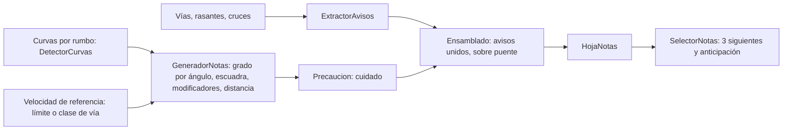

# Glosario de copiloto (notas de rally)

> Propósito: fijar qué frases genera el motor de notas, cuándo salen y con qué umbral · Audiencia: agente principal, Joan y quien calibre o revise las notas (H3, H11) · Actualizado: 2026-11-07 · Relacionado: docs/DECISIONES.md § Notas de rally, docs/investigacion/notas-de-rally.md (histórica), docs/arquitectura.md

## Resumen
Este glosario describe lo que **de verdad** produce `motor/` (paquete `notas`) en v1.2.0, no un borrador: cada frase, su condición y un ejemplo real de los goldens `motor/src/test/resources/notas/ma-2141-hoja.txt` y `ma-10-hoja.txt`. Una nota tiene la forma `[cuidado,] [avisos unidos,] dirección grado [modificadores] [sobre puente] [, distancia]`, con dirección siempre primero. Desde H13 el grado sale **solo del giro total de la curva** (ángulo), y desde H14a las curvas se detectan **por rumbo**; el radio solo sirve para «cierra», «abre», la escuadra y el encadenado. Las decisiones y su motivo están en `docs/DECISIONES.md § Notas de rally` (2026-11-03 y 2026-11-06): aquí no se copian. Los umbrales son calibrables y los números de este documento son los valores por defecto del código; si cambian, manda el código.

Los goldens llevan al final de cada línea una anotación `[ángulo° R radio m]` que **no** se canta: sirve para revisar la nota a ojo.

## Forma de la frase de una curva

| Parte | Regla | Fuente |
|---|---|---|
| `cuidado,` | Si la nota lleva marca de precaución, o un aviso «cuidado» (resalto, badén, cuidado) va unido. Va siempre primero y se dice una sola vez. | `Precaucion.marcar`, `ElementoHoja.DeNota.frase` |
| Avisos unidos | Avisos a menos de 20 m antes de la nota, también dentro de una cadena «y». Excepción: un cambio de rasante dentro de una cadena «y» se descarta. Ej.: «rasante, derecha tres». | `Ensamblado.unir` (`UNION_MAX_M` = 20) |
| Dirección | «izquierda» o «derecha». Siempre primero. | `FrasesNota.giro` |
| Grado | «uno» a «seis» (en palabras) según el ángulo girado (§ Grados por ángulo), o la palabra simplificada (§ Notas simplificadas). Horquilla: sin grado. Escuadra: la palabra «escuadra» en lugar del grado. | `FrasesNota.giro`, `FrasesNota.enPalabras` |
| Modificadores | `larga` o `muy larga`, luego `cierra` o `abre`; o solo `escuadra`. | `GeneradorNotas.modificadores` |
| «sobre puente» | Un puente que cae dentro del arco de la curva; se canta al final de la nota, antes de la distancia. | `Ensamblado.unir` (`sobrePuente`) |
| Distancia | `, y el número en palabras` si el hueco hasta la siguiente no va unido. Ej.: «, cincuenta». | `GeneradorNotas.distanciaA` |
| «y» | Sin distancia cuando la nota va unida a la siguiente. El motor no escribe la «y» en la frase de la hoja; la añade el test de los goldens (`HojaNotasRealTest`). `FrasesNota.secuencia` une con « y » o separa con «. » para la voz. | `Nota.unidaConSiguiente`, `FrasesNota.secuencia` |

Horquilla: «horquilla izquierda» o «horquilla derecha», con `larga` o `muy larga` si el arco lo pide. Sin grado y sin `cierra` ni `abre`. Escuadra: «izquierda escuadra» o «derecha escuadra» (§ Escuadra); no lleva grado, `larga` ni `cierra`/`abre`.

### Ejemplos reales de curvas (goldens)

| Frase del golden | Qué muestra | Golden |
|---|---|---|
| `460 m  izquierda cinco, treinta  [39° R89 m]` | 39° es grado 5; distancia 30 m a la nota siguiente | ma-2141 |
| `585 m  derecha seis, cien  [17° R158 m]` | 17° es grado 6 («casi recta»), distancia 100 m | ma-2141 |
| `885 m  izquierda seis y  [12° R250 m]` | Grado 6 unido («y») a la siguiente | ma-2141 |
| `1150 m  izquierda tres, cincuenta  [99° R27 m]` | 99° es grado 3 | ma-2141 |
| `1770 m  derecha cuatro cierra y  [79° R28 m]` | Modificador «cierra», unida | ma-2141 |
| `1830 m  izquierda tres muy larga y  [119° R135 m]` | «muy larga» por arco (≥ 200 m), no por ángulo | ma-2141 |
| `290 m  izquierda cuatro larga abre, cuarenta  [65° R247 m]` | «larga» y «abre» juntos, con distancia | ma-2141 |
| `140 m  cuidado, derecha uno larga cierra sobre puente y  [163° R51 m]` | Precaución por «uno» que cierra, «larga», «sobre puente», unida | ma-2141 |
| `1385 m  cuidado, izquierda uno cierra y  [177° R11 m]` | 177° es grado 1 (el más cerrado antes de la horquilla) | ma-2141 |
| `1560 m  cuidado, horquilla derecha, cincuenta  [195° R13 m]` | Más de 180°: horquilla, sin grado, con distancia | ma-2141 |
| `3185 m  cuidado, puente, horquilla derecha larga y  [265° R19 m]` | La corbata: puente unido antes de la horquilla, «larga», unida | ma-2141 |
| `4865 m  horquilla derecha muy larga y  [192° R148 m]` | Horquilla «muy larga» (arco ≥ 200 m), sin «cuidado» | ma-2141 |
| `9605 m  izquierda cuatro larga abre sobre puente, cincuenta  [69° R102 m]` | «sobre puente» dentro del arco, con distancia | ma-2141 |
| `8010 m  cuidado, izquierda dos larga abre, ciento veinte  [126° R157 m]` | «ciento veinte» (120 m) | ma-2141 |
| `6450 m  derecha seis, ciento cincuenta  [20° R120 m]` | «ciento cincuenta» (150 m) | ma-2141 |
| `0 m  cruce, izquierda seis y  [29° R65 m]` | Aviso «cruce» unido a la nota | ma-10 |
| `990 m  ceda el paso, izquierda cinco, cien  [46° R33 m]` | Aviso «ceda el paso» unido, con distancia | ma-10 |
| `7955 m  cuidado, resalto, izquierda seis y  [22° R137 m]` | «Resalto» unido tras «cuidado» | ma-10 |

Los goldens vigentes no contienen ninguna «escuadra»: su frase y su regla se cubren con los tests de `GeneradorNotas`.

## Grados por ángulo

Desde H13 (v1.1.0, 2026-11-03) el grado depende **solo del giro total** de la curva, no del radio ni de la velocidad de la vía (`TablaGrados.gradoPorAngulo`). La decisión, la petición de Joan y la escala que sustituye (radio y velocidad de referencia, de H3) están en `docs/DECISIONES.md § Notas de rally` (2026-11-03).

| Ángulo girado | Nota |
|---|---|
| menor de 10° | No se canta (`anguloMinimoGrados`) |
| 10° a 30° | 6 (casi recta) |
| 30° a 60° | 5 |
| 60° a 90° | 4 |
| 90° a 120° | 3 |
| 120° a 150° | 2 |
| 150° a 180° | 1 (la más cerrada) |
| más de 180° | Horquilla (sin grado) |

En el límite exacto gana el número mayor: 30° es 6, 60° es 5, 180° es 1 y 181° es horquilla. El radio ya no cambia el grado: una curva de 40° sale «cinco» aunque su radio sea de 20 m.

### Escuadra

Una curva de **70° a 110°** con arco de **30 m o menos** y radio mínimo de **15 m o menos** (un ángulo recto cerrado y lento) se canta «derecha escuadra» o «izquierda escuadra» (`Modificador.ESCUADRA`). Cuenta como grado 3 para las comparaciones internas (precaución por salto de grado) y como «muy cerrada» en las notas simplificadas; no lleva «larga» ni «cierra»/«abre». Una curva de unos 90° más abierta (arco largo o radio mayor de 15 m) sigue siendo un 3 o un 4 normal. Se reconoce también por voz (`InterpreteOrdenes`; H14a la da por resuelta, VERIFICAR con la prueba en coche).

### Horquilla

Más de 180° de giro: «horquilla izquierda» o «horquilla derecha», sin grado. Puede llevar «larga» o «muy larga» (por arco) pero nunca «cierra» ni «abre». Desde H13 no hay umbral de radio: lo único que decide es el ángulo. Ejemplo: `3185 m  cuidado, puente, horquilla derecha larga y  [265° R19 m]`.

### Cómo se detectan las curvas (H14a)

Desde H14a (v1.2.0) `DetectorCurvas` segmenta la traza **por rumbo**, no por radio: ya no exige un radio menor de 400 m para abrir una curva. El zigzag se filtra con una inversión de 4°, las rachas casi rectas separan y recortan curvas, el mínimo es 5° en el detector y 10° en el generador, y el radio tiene tope de 10 km. Los parámetros y los resultados medidos en la traza real de Joan están en `docs/DECISIONES.md § Notas de rally` (2026-11-06). Consecuencia: cualquier giro de 10° o más acaba cantándose, y en rectas no salen notas.

### Qué sigue dependiendo del radio

El radio y la **velocidad de referencia** (vRef: el límite de la vía o, sin él, el de su clase) ya no deciden el grado, pero se usan para:

- **«Cierra» y «abre»:** los grados de entrada y de salida se calculan de los radios con `TablaGrados.grado(radio, vRef)`: con vRef, bandas relativas `r = v_curva / vRef` de 0,45 / 0,60 / 0,72 / 0,86 / 1,0; sin vRef, umbrales absolutos de 45 / 65 / 85 / 110 / 140 km/h. La velocidad de curva es `v_curva = √(μ·g·R)·3,6·factor` (μ = 0,6 por defecto).
- **Encadenado con «y»** (§ Distancias) y perfil de velocidad.
- **Velocidad de referencia por clase** (si la vía no tiene `maxspeed`), en `VelocidadReferencia`, `app/.../data/notas/GeneracionHoja.kt`: `motorway` 120, `trunk`/`primary`/`secondary`/`tertiary` 90, `unclassified` 70, `residential` 50, `living_street` 20 km/h; las `*_link` heredan la de su vía; otras clases, sin referencia. Son estimaciones (VERIFICAR, QUESTIONS).
- **Calles:** `GeneradorHoja.generar` no genera notas de curva cuya velocidad de referencia al inicio sea ≤ 30 km/h (`sinCurvasHastaKmh`); sin referencia no se descarta ninguna. Los goldens no lo aplican (se generan sin referencia).

## Modificadores

| Modificador | Condición (código) | Frase |
|---|---|---|
| Escuadra | Ángulo 70–110°, arco ≤ 30 m y radio mínimo ≤ 15 m. Excluye a los demás | «escuadra» (sustituye al grado) |
| Larga | Longitud de arco (fin − inicio) ≥ 100 m | «larga» |
| Muy larga | Arco ≥ 200 m. Sustituye a «larga» | «muy larga» |
| Cierra | Grado ≤ 4; arco ≥ 40 m; grado de salida < grado de entrada; R entrada / R salida ≥ 1,4 | «cierra» |
| Abre | Grado ≤ 4; arco ≥ 40 m; grado de salida > grado de entrada; R salida / R entrada ≥ 1,6 | «abre» |

- «Larga» y «muy larga» van por **longitud de arco**, no por ángulo (cambio de H13): una curva de 119° es «muy larga» si su arco pasa de 200 m (`1830 m  izquierda tres muy larga y  [119° R135 m]`).
- Los grados de entrada y de salida de «cierra»/«abre» salen de los radios de entrada y de salida, con la misma vRef (§ Qué sigue dependiendo del radio).
- Orden: primero larga/muy larga, luego cierra/abre (orden del enum `Modificador`). Como máximo sale una de cada pareja.
- Las horquillas pueden llevar «larga» o «muy larga», pero nunca «cierra» ni «abre».

## Distancias

- El hueco es el de `finM` de una curva a `inicioM` de la siguiente, redondeado **hacia abajo** a esta lista: 10, 20, 30, 40, 50, 60, 70, 80, 100, 120, 150, 200, 250, 300, 400, 500, 600, 700, 800 metros.
- Se cantan en palabras con `enPalabras` (0–999): «cincuenta», «cien», «ciento veinte», «doscientos cincuenta», «seiscientos». Un hueco mayor de 800 m se canta «ochocientos».
- **Unida** («y», sin distancia) si el hueco es < 20 m **o** < 1 s a la velocidad de la curva (topada a 130 km/h), con `min(v_curva, vRef)` si hay referencia. El último de la ruta no lleva distancia.

## Avisos

Avisos de `ExtractorAvisos` (`TipoAviso`). Se cantan solos o unidos a una nota. Dos del mismo tipo a menos de 30 m se reducen a uno (`sinDuplicados`).

| Frase | Origen | Cuándo sale | Ejemplo real (golden) |
|---|---|---|---|
| puente | `bridge` distinto de `no` en una vía de la ruta | Al empezar el tramo de puente. Si cae dentro del arco de una curva, sale como «sobre puente» al final de la nota | ma-10 `745 m  puente`; ma-2141 `9605 m  izquierda cuatro larga abre sobre puente, cincuenta` |
| túnel | `tunnel` distinto de `no` ni `culvert` | Al empezar el tramo de túnel | ma-10 `9535 m  túnel` |
| rotonda | `junction=roundabout` | Al empezar el tramo; los cruces a 25 m o menos antes de una rotonda no salen | Sin ejemplo en los goldens |
| estrecha | `lanes=1` en vía de doble sentido, o `width` < 5 m | Al empezar el tramo | Sin ejemplo en los goldens |
| resalto | Nodo `bump`, `hump`, `table`, `cushion`, `rumble_strip(s)`, `speed_bump`, `speed_hump` o `speed_table`. Frase «cuidado, resalto» (la palabra «resalto» si va unido) | En el nodo | ma-2141 `12386 m  cuidado, resalto`; ma-10 `7955 m  cuidado, resalto, izquierda seis y` |
| cuidado badén | Nodo `dip` o `ford`. Frase «cuidado badén» (unido: «cuidado, badén») | En el nodo | Sin ejemplo en los goldens |
| paso a nivel | Nodo `level_crossing` o `railway_crossing` | En el nodo | ma-10 `1024 m  paso a nivel` |
| stop | Nodo `highway=stop`, solo si es de nuestra vía (ver abajo) | En el nodo | ma-10 `7876 m  stop`; ma-2141 `5 m  stop` |
| ceda el paso | Nodo `give_way`, solo si es de nuestra vía (ver abajo) | En el nodo | ma-10 `322 m  ceda el paso` |
| semáforo | Nodo `traffic_signals` | En el nodo | Sin ejemplo en los goldens |
| cruce | Nodo del grafo que es cruce (3 o más ramas) con una rama de rango ≥ unclassified o giro > 30° (`GrafoVias.cruces`, docs/DECISIONES.md § calibración de notas (H3)), fuera de rotondas. Desde H14a no se avisa si la ruta va por `motorway`, `trunk` o `*_link`, ni si las demás ramas son `*_link` (docs/DECISIONES.md § Notas de rally, 2026-11-06) | En el cruce | ma-2141 `10797 m  cruce`; ma-10 `0 m  cruce, izquierda seis y` |
| rasante | Cresta del perfil MDT05: pendiente de subida ≥ 4 % seguida de bajada ≤ −2 % en 60 m (`pendienteSubidaCrestaPct`, `pendienteBajadaCrestaPct`, `ventanaCrestaM`) | En la cresta | ma-2141 `2658 m  rasante` |
| cambio de rasante | Solo convexo: la pendiente baja ≥ 8 puntos en menos de 40 m (`variacionCambioPuntos`, `ventanaCambioM`). No sale si la racha contiene una cresta | En el cambio | ma-2141 `3623 m  cambio de rasante` |
| compresión | Vaguada cóncava marcada, simétrica del cambio de rasante: la pendiente sube ≥ 10 puntos en menos de 40 m (`variacionCompresionPuntos`, `ventanaCompresionM`). Umbral propio, más exigente que el convexo (8) para no avisar vaguadas suaves del MDT; con 8 saldrían 13 en los dos goldens y con 10 salen 5 | En la vaguada | ma-10 `15458 m  compresión`; ma-2141 `3565 m  compresión, izquierda dos abre, treinta` |
| salto | Cresta con caída de pendiente ≥ 20 puntos en menos de 30 m (`variacionSaltoPuntos`, `ventanaSaltoM`) | En la cresta | ma-2141 `10047 m  salto` |
| cuidado | `hazard=*` de la vía, nodo `hazard:*`, o `hazard:curve` sin nota a 30 m (suelto) | En el punto | Sin aviso suelto «cuidado» en los goldens; sale junto a notas como «cuidado,» |

- **Rasantes:** prioridad salto > rasante > cambio de rasante = compresión (a igual prioridad gana la primera). Dos rasantes a menos de 60 m (`separacionM`) se quedan con la de mayor prioridad. Las rasantes a 30 m o menos de un extremo de puente o túnel se descartan (artefacto del MDT, `JUNTA_M`).
- **Stop y ceda de un cruce:** no se avisan si la ruta llega por la vía principal del cruce (de mayor rango, o de igual rango con la misma `ref`). En un nodo que no es cruce, siempre se avisan. Un nodo sin aristas (no está en el grafo) también sale.
- **Unión:** los avisos a menos de 20 m antes de una nota se cantan con ella: «salto, izquierda seis y» (ma-10 `25110 m`). Dentro de una cadena «y», un cambio de rasante se descarta; los demás avisos (también la compresión: «compresión, derecha cuatro») se unen igual.
- Los avisos que no se unen salen sueltos, en su posición.

## Precaución («cuidado,»)

Marcas generosas a propósito (docs/DECISIONES.md § Respuestas de Joan a QUESTIONS.md (2026-10-28)). Una nota lleva «cuidado,» si cumple **una** de estas (`Precaucion.marcar`):

| Motivo | Umbral |
|---|---|
| Cierra fuerte | Grado 1–2 y «cierra» |
| Rasante antes | Grado 1–3 u horquilla, con rasante, salto o cambio de rasante en los 60 m anteriores |
| Salto de grado | Dos o más grados más cerrada que la nota anterior, a menos de 150 m de ella, y sin horquilla a menos de 400 m antes de la nota |
| Horquilla tras recta | Horquilla tras más de 300 m sin curva |
| Peligro en la curva | `hazard:curve` a 30 m o menos de la curva |

Un aviso «cuidado» unido a una nota que ya lleva «cuidado,» no se repite: la frase lo dice una sola vez, al principio.

Ejemplos: ma-2141 `140 m  cuidado, derecha uno larga cierra sobre puente y` y `3445 m  cuidado, derecha dos larga cierra y` (cierra fuerte); ma-2141 `4133 m  cambio de rasante` seguido de `4180 m  cuidado, izquierda uno y` (rasante antes, a 47 m).

## Notas simplificadas

Modo «simplificada» (Ajustes): solo cambia el grado por palabra (`GradoSimplificado`); dirección, horquilla, modificadores, sobre puente, distancias y avisos se mantienen.

| Grado | Palabra |
|---|---|
| Horquilla | horquilla |
| 1 y escuadra | muy cerrada |
| 2 | cerrada |
| 3–4 | media |
| 5–6 | suave |

Ej.: «derecha cuatro abre, cincuenta» → «derecha media abre, cincuenta»; «izquierda uno» → «izquierda muy cerrada».

## Niveles de anticipación

Distancia para empezar a cantar: `d = v · (T_nivel + t_voz)`, con `t_voz` = 1 s, acotada a [40 m, 400 m] (`Anticipacion`). `T_nivel` por nivel (`NivelAnticipacion`):

| Nivel | T (s) | Distancia a 25 m/s (90 km/h) |
|---|---|---|
| MUY_PRONTO | 8,0 | 225 m |
| PRONTO | 6,5 | 188 m |
| NORMAL | 5,0 | 150 m |
| TARDE | 3,5 | 113 m |
| MUY_TARDE | 2,5 | 88 m |

- `SelectorNotas` devuelve los 3 siguientes elementos desde 5 m por detrás de la posición; `activa` es `true` cuando la distancia ya está dentro de `d`.
- Las distancias de la tabla son cálculos con los valores del código, no pruebas en carretera.

## Decisiones y fuentes

- Grado por ángulo y escuadra (H13, 2026-11-03), detección de curvas por rumbo y cruces y enlaces (H14a, 2026-11-06): docs/DECISIONES.md § Notas de rally.
- Calibración de notas (H3), 2026-10-31 (bandas relativas a la velocidad de referencia, ya sin efecto sobre el grado; cambio de rasante solo convexo, stop/ceda de nuestra vía, cruces, «resalto» y «sobre puente»): docs/DECISIONES.md, entrada «calibración de notas (H3)».
- Calibración, orden dirección-grado, distancias después de la nota, grado 6 cantado y avisos generosos: docs/DECISIONES.md § Respuestas de Joan a QUESTIONS.md (2026-10-28).
- Notas en la franja, notas en modo libre y anticipación en Ajustes: docs/DECISIONES.md § Motor de notas (H3).
- Pipeline y μ = 0,6 (propuestas; la tabla radio-grado de esa investigación está superada): docs/investigacion/notas-de-rally.md.
- Código de referencia: `motor/src/main/kotlin/app/trombito/rallycopilot/motor/notas/` (`FrasesNota.kt`, `Nota.kt`, `Avisos.kt`, `TablaGrados.kt`, `GeneradorNotas.kt`, `HojaNotas.kt` con `Precaucion`, `Anticipacion.kt`, `DetectorRasantes.kt`, `DetectorCurvas.kt`); `motor/vias/GrafoVias.kt` para el criterio de cruce; `app/.../data/notas/GeneracionHoja.kt` para la velocidad de referencia por clase.
- Goldens: `motor/src/test/resources/notas/ma-2141-hoja.txt` (Ma-2141, 142 líneas) y `ma-10-hoja.txt` (Ma-10, 270 líneas). Regenerados con la escala por ángulo y la detección por rumbo; cada línea de curva lleva `[ángulo° R radio m]`.

- Vocabulario (Joan, 2026-11-01): «compresión» para las vaguadas fuertes y «muy cerrada» para el grado 1 simplificado.

## Pendiente
- **H11 (refinar con transcripciones reales):** si dicen «izquierda» o «izda.»; «recto» o «a fondo» para el grado 6; cómo cantan los grados 5–6; si la distancia va antes o después de la nota (ya decidido: después); «contra», «corta», «abierta»; «cierra a dos» (grado final); pausa de la voz entre notas unidas («y» o punto); cuántas precauciones «cuidado» tolera el piloto.
- Frases sin ejemplo en los goldens (rotonda, estrecha, cuidado badén, semáforo, cuidado suelto): confirmar con un tramo de Mallorca que las tenga.
- Umbrales de ángulo, escuadra, μ y velocidades de referencia por clase: calibrar en carretera con la prueba en coche de Joan (VERIFICAR). Los límites por clase son estimados.
- Cobertura de `width` y `lanes` fuera de Ma-2141 (VERIFICAR, ver docs/investigacion/notas-de-rally.md).

> Pendiente: revisión de copiloto-reviewer (glosario reescrito en L13 de H15 sobre H13 y H14a).
